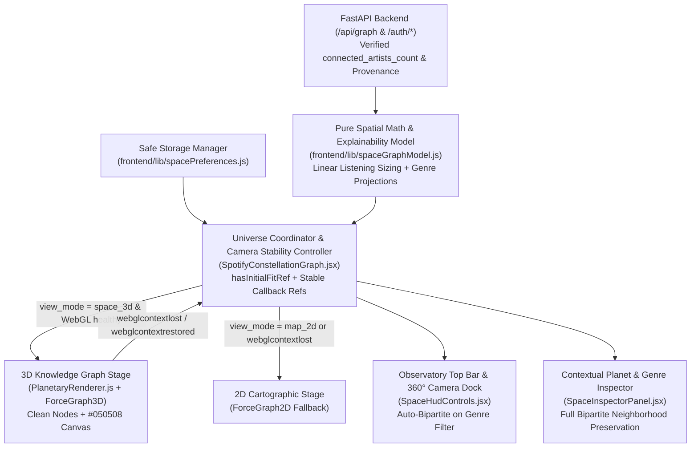

# BeatCode Space Design — 3D Knowledge Graph (Graphify-Inspired)

**Spec**: `.specs/features/beatcode-space/spec.md`
**Status**: Approved

---

## Architecture Overview

**Recommended Approach (Selected):** Modular 3D/2D Knowledge Graph Universe (`react-force-graph-3d` + `three` + `react-force-graph-2d`) inspired by Graphify, backed by a pure, deterministic mathematical & explainability layer (`frontend/lib/spaceGraphModel.js`), a defensive client preference storage layer (`frontend/lib/spacePreferences.js`), and a verified FastAPI contract (`backend/main.py` + `backend/tests/test_api.py` + `openspec/openapi.yaml`).

The visual language shifts from speculative planetary elements (atmospheric halos, Saturn-like rings, procedural starry skies) to an authoritative **3D Knowledge Graph inspired by Graphify**: clean 3D node spheres and polyhedra, explainable luminous edge trajectories, cohesive Louvain knowledge cluster envelopes, and a calm, discreet dark canvas (`#050508`).



---

## Code Reuse Analysis

### Existing Components to Leverage

| Component | Location | How to Use |
| --------- | -------- | ---------- |
| `compute_unipartite_artist_graph` & `compute_bipartite_artist_genre_graph` | `backend/main.py` | Authoritative backend graph engine; normalized so `connected_artists_count` is explicitly present on every `GraphNode` (`int >= 1` on `genre` nodes, `None` on `artist` nodes) and verified by integration tests in `backend/tests/test_api.py` |
| `SpotifyConstellationGraph` | `frontend/components/SpotifyConstellationGraph.jsx` | Evolved to coordinate welcome/auth state, 3D/2D stage switching, WebGL context-loss/recovery, camera controller, keyboard shortcuts (`/` and `Escape`), `hasInitialFitRef` hover zoom protection, and modular child components |
| `globals.css` | `frontend/app/globals.css` | Extended with BeatCode Space clean knowledge graph tokens (`--space-void: #050508`, glassmorphic HUD surfaces, `@media (prefers-reduced-motion: reduce)` rules) |

### Integration Points

| System | Integration Method |
| ------ | ------------------ |
| FastAPI `/api/graph` | `GET /api/graph?time_range=...&graph_mode=...&limit=50&demo=...` with `credentials: "include"` and `cache: "no-store"` |
| FastAPI `/auth/*` | Existing browser-isolated `beatcode_session` cookie flow (`/auth/status`, `/auth/login`, `/auth/logout`) |
| Browser `localStorage` | Key `beatcode_space_prefs_v1` accessed exclusively through `frontend/lib/spacePreferences.js` with schema sanitization and memory fallback |

---

## Deterministic Mathematical Model & Backend Data Provenance Contract

### 1. Tripartite Spotify Data Source Separation & Zero Fictitious Counts Invariant

All metrics surfaced in BeatCode Space belong strictly to one of three non-fungible data sources, governed by the invariant that zero synthetic or fictitious stream numbers may ever be generated:

1. **A. Reprodução Observada (`observed_plays`):**
   - Verified playback events captured from Spotify history (`recent_tracks` with ISO timestamp `played_at`, or verified playback logs).
   - Identifies the exact observation window and deduplicates tracks within sessions.
   - Expressed exclusively as observed playback events.

2. **B. Afinidade Spotify (`affinity_rank`, `affinity_score`, `top_tracks_count`):**
   - Ordinal positions and algorithmic affinity scores ($S_{\text{aff}} \in [0.25, 1.00]$) provided by Spotify's Top Artists / Top Tracks endpoints.
   - Tagged as `[DADO SPOTIFY]` and `[INFERÊNCIA BEATCODE]`.
   - MUST NEVER be labeled, converted, or displayed as an absolute number of streams or plays.

3. **C. Biblioteca Salva (`saved_tracks_count`):**
   - Aggregate count of tracks saved by the user in their personal library (`saved_tracks`).
   - Represents personal archival curation, and MUST NEVER increment or be combined with listening counts.

#### Zero Fictitious Counts & Estimated Listening Index
If empirical playback logs are absent or insufficient for absolute counts, $L_i$ cleanly transitions to an **Índice Estimado de Escuta** (`estimated_listening_index`):
- Explicitly identified and labeled as an estimated index in the UI.
- Displays transparent methodology: composite of Spotify affinity rank/score and top-tracks presence across the selected time horizon.
- MUST NEVER be presented as an absolute stream or play count.

### 2. Mathematical Summary (`frontend/lib/spaceGraphModel.js`)

All mathematical rules defined in `spec.md` are implemented as pure, deterministic functions with zero randomness and explicit input sanitization:

- **Input Normalization & Fallbacks:**
  - $\hat{S}_{\text{aff}}(u) = \text{clamp}\left(\frac{\text{clamp}(S_{\text{aff}}(u) \ ?? \ 0.50, \ 0.25, \ 1.00) - 0.25}{0.75}, \ 0.0, \ 1.0\right)$
  - $\hat{P}_{\text{glob}}(u) = \frac{\text{clamp}(P_{\text{glob}}(u) \ ?? \ 50, \ 0, \ 100)}{100.0} \in [0.0, 1.0]$
  - $C_D(u) = \text{clamp}(u.\text{metrics?.degree\_centrality} \ ?? \ 0.0, \ 0.0, \ 1.0)$
  - $C_B(u) = \text{clamp}(u.\text{metrics?.betweenness\_centrality} \ ?? \ 0.0, \ 0.0, \ 1.0)$
  - $k_g = \text{clamp}(u.\text{connected\_artists\_count} \ ?? \ \deg(g), \ 1, \ 50)$ for `node_type === "genre"`, and `null` for `node_type === "artist"`.

- **Deterministic Linear Listening Sizing Formula ($L_i$):**
  $$D_i = D_{\max} \times \left(\frac{L_i}{L_{\max}}\right), \quad R_i = \frac{D_i}{2}$$
  Where $L_i$ is evidence-backed: either `observed_plays` (when available) or `estimated_listening_index` (transparently labeled).
  - **Mandatory Proportionality Examples:**
    - $1000$ vs $500 \implies 2.0\times$
    - $1000$ vs $750 \implies \frac{4}{3} \approx 1.3333\times$
    - $1500$ vs $1000 \implies 1.5\times$
  - **Separate Maximum Sizing Scales:**
    - Artists: $D_{\max,\text{artist}} = 28.0 \implies R_{\max,\text{artist}} = 14.0$
    - Genres: $D_{\max,\text{genre}} = 24.0 \implies R_{\max,\text{genre}} = 12.0$
  - **Deduplicated Genre Listening Aggregation on `(track_id, genre)` Key ($L_g$):**
    Each unique track associated with genre $g$ contributes its play count (or listening weight) exactly once to $L_g$, even when multiple collaborating artists on that track belong to the same genre $g$.
  - **Safe Missing/Invalid Fallback ($L_i \le 0$ or `NaN`):**
    `listeningRatio = 0`, `isFallbackListening = true`, $R_{\min,\text{safe}} = 2.0$ ($D_{\min,\text{safe}} = 4.0$) strictly for 3D visibility without distorting the strictly linear ratio of nodes with valid $L_i > 0$.

- **Graphify-Inspired Visual Encoding:**
  - Deep discreet canvas: `#050508` (no starfield or space dust).
  - Clean avatar spheres and faceted hubs; zero atmospheric halos or Saturn rings.
  - Knowledge cluster envelopes on active Louvain communities.

- **Genre Graph Cohesion & Projected Edges:**
  - When filtering by `genre`, the graph auto-switches to `bipartite`.
  - Projected `genre-genre` edges in `filterSpaceGraph`:
    $$W(g_1, g_2) = \frac{|A(g_1) \cap A(g_2)|}{|A(g_1) \cup A(g_2)|} \in [0.0, 1.0]$$
  - Full neighborhood preservation in the Inspector.

- **Hover Camera Zoom Stability Architecture:**
  - `hasInitialFitRef = useRef(false)` prevents `zoomToFit` on subsequent `onEngineStop` invocations after initial stabilization.
  - Stable callback references for `onNodeHover`, `onLinkHover`, and `onNodeClick` avoid re-creating `<ForceGraph3D>` props.

- **3D Knowledge Cluster Centroids ($\mathbf{C}_k$):**
  - $R_{\text{galaxy}} = 220.0 \cdot (1.0 + 1.8 \cdot \max(0.0, Q)) \in [220.0, 616.0]$, distributed via Golden Angle $\varphi = \pi(3 - \sqrt{5})$.

- **4-Attribute Edge Weight Composition (`0.65g + 0.25c + 0.10t` + `shared_genres`):**
  - $C_g = \text{round}(0.65g, 4)$, $C_c = \text{round}(0.25c, 4)$, $C_t = \text{round}(0.10t, 4)$, $W_{\text{calc}} = \text{round}(\text{clamp}(C_g + C_c + C_t, 0, 1), 4)$.
  - `shared_genres` ($u.\text{genres} \cap v.\text{genres}$) qualifies $C_g$ (`"exact_and_subtoken_match"`, `"subtoken_lexical_match"`, or `"none"`).

- **2-Hop Multi-Path Harmonic Relevance:**
  - $A_{2\text{hop}}(u, z) = \text{round}\left(1.0 - \prod_{m \in M(u, z)} (1.0 - 0.70 \cdot W(u, m) \cdot W(m, z)), \ 4\right)$, sorted descending by $A_{2\text{hop}}$, then descending by $|M(u, z)|$, then ascending by $z.\text{name}$ (top 8).

### 2. Backend Contract & Provenance Separation (`backend/main.py` & `openspec/openapi.yaml`)

Inspection of `backend/main.py` confirmed that `compute_bipartite_artist_genre_graph` (line 806) returns `"connected_artists_count": connected_count` on `node_type == "genre"` nodes, whereas `node_type == "artist"` nodes omit the key, and `openspec/openapi.yaml` + `backend/tests/test_api.py` did not validate it. In **T3**:

1. `backend/main.py` is normalized so every `GraphNode` dictionary explicitly includes `"connected_artists_count"` (`None` on `artist` nodes in both `artists` and `bipartite` modes; `int >= 1` on `genre` nodes in `bipartite` mode).
2. `openspec/openapi.yaml` documents `connected_artists_count` as `type: [integer, "null"]` on `GraphNode`.
3. `backend/tests/test_api.py` adds `test_graph_endpoint_delivers_connected_artists_count_and_provenance_contract` to verify the live `/api/graph` payload in both modes.
4. `spaceGraphModel.js` and `SpaceInspectorPanel.jsx` enforce the strict provenance separation:
   - **`[DADO SPOTIFY]` (Measured Source Data):** `name`, `affinity_rank`, `global_popularity`, `genres`, `top_tracks`, `spotify_url`, `image_url`.
   - **`[INFERÊNCIA BEATCODE]` (Calculated Topological Metrics):** `affinity_score`, `metrics.degree_centrality`, `metrics.betweenness_centrality`, `cluster_id`, `connected_artists_count`, `weight`, `components` (`0.65g + 0.25c + 0.10t`), `shared_genres`, and $A_{2\text{hop}}$.

---

## Components

### 1. `spaceGraphModel` (Pure Domain, Astrophysical Math & Explainability Layer)

- **Purpose**: Computes deterministic planetary visual attributes, 3D Fibonacci cluster centroids, node/edge filtering, search matching, 1-hop direct connections, 2-hop harmonic indirect connections, 4-attribute edge weight explanations (`0.65g + 0.25c + 0.10t` + `shared_genres`), data provenance classification (`[DADO SPOTIFY]` vs `[INFERÊNCIA BEATCODE]`), reduced-motion configuration, WebGL fallback/context recovery transitions, 3D camera flight target coordinates, and HTML sanitization (`escapeHtml`).
- **Location**: `frontend/lib/spaceGraphModel.js`
- **Owner**: `Engenheiro de IA e Agentes`
- **Interfaces**:
  - `computePlanetVisualProps(node, metadata, graphMode, links): PlanetVisualProps`
  - `computeClusterCentroids(clusters, modularityScore): Map<number, ClusterCentroid3D>`
  - `decomposeEdgeWeight(link, graphMode): EdgeExplanation` - Computes $C_g, C_c, C_t, W_{\text{calc}}$, and `genreMatchType` (`"exact_and_subtoken_match"` | `"subtoken_lexical_match"` | `"none"`).
  - `filterSpaceGraph(graphData, filterState): FilteredSpaceGraph`
  - `computeNodeNeighborhood(nodeId, filteredGraph): NodeNeighborhood`
  - `buildNodeProvenanceProfile(node, graphMode): { spotifyFacts, beatcodeInferences }`
  - `deriveExplorationDepth({ selectedNode, focusedClusterId }): "universe" | "star_system" | "planet_orbit"`
  - `resolveCameraFlightTarget({ action, node, clusterCentroid, reducedMotion }): CameraFlightTarget`
  - `computeMotionConfig({ prefersReducedMotion, userReducedMotion }): MotionConfig`
  - `resolveWebGLFallbackState(currentState, eventType): WebGLFallbackState`
  - `escapeHtml(input): string`
- **Dependencies**: None (pure ES module, zero DOM/Three.js imports, 100% testable under `node --test`).
- **Reuses**: Mathematical formulas from `docs/REVISAO_MODELO_MATEMATICO.md` and `docs/PROPOSTA_INTERPRETABILIDADE.md`.

### 2. `spacePreferences` (Safe Client Persistence Layer)

- **Purpose**: Manages reading, validating, clamping, and persisting non-sensitive UI preferences (`beatcode_space_prefs_v1`) with fallback for restricted storage environments.
- **Location**: `frontend/lib/spacePreferences.js`
- **Owner**: `Engenheiro de Banco de Dados local`
- **Interfaces**:
  - `loadSpacePreferences(storage?): BeatCodeSpacePreferences`
  - `saveSpacePreferences(partialPrefs, storage?): BeatCodeSpacePreferences`
  - `recordVisitedPlanet(node, currentPrefs, storage?): BeatCodeSpacePreferences`
  - `sanitizeSpacePreferences(raw): BeatCodeSpacePreferences`
- **Dependencies**: None (accepts injectable `storage` for unit testing under `node --test`).
- **Reuses**: Privacy and zero-secret rules from `AGENTS.md`.

### 3. `PlanetaryRenderer` (Three.js 3D Celestial Scene, WebGL Context Guard & GPU Lifecycle)

- **Purpose**: Builds Three.js planetary meshes (artist spheres with Spotify/procedural textures, Fresnel atmosphere halos, tilted orbital rings, emissive octahedron genre star-cores, crisp pill label sprites with LOD, and background cosmic starfield), binds `webglcontextlost` / `webglcontextrestored` listeners, and guarantees full GPU resource disposal (`disposeThreeUniverse`).
- **Location**: `frontend/components/space/PlanetaryRenderer.js`
- **Owner**: `UI/UX Designer + Desenvolvedor Front-end + Acessibilidade`
- **Interfaces**:
  - `createPlanetObject3D(node, visualProps, options, resourceRegistry): THREE.Group`
  - `createCosmicStarfield(starCount, radius, resourceRegistry): THREE.Points`
  - `configureSpaceForces3D(fgInstance, { graphMode, clusterCentroids, nodes }): void`
  - `attachWebGLContextListeners(canvasElement, { onContextLost, onContextRestored }): () => void`
  - `disposeThreeUniverse(scene, resourceRegistry): DisposalReport`
- **Dependencies**: `three`, `frontend/lib/spaceGraphModel.js`
- **Reuses**: `CLUSTER_PALETTE` colors and procedural canvas patterns.

### 4. `SpaceHudControls` (Observatory Top Bar, Search, Camera Dock & Depth Indicator)

- **Purpose**: Renders the compact top navigation bar (mode switch, time horizon, edge threshold, 3D/2D toggle, search input with `/` shortcut, type filter), exploration depth badge (`Universo` / `Sistema Estelar` / `Órbita Planetária`), and 360° camera dock (`+`, `−`, `Centralizar Planeta`, `Visão Geral do Universo`, `Auto-Órbita`, `Legenda`).
- **Location**: `frontend/components/space/SpaceHudControls.jsx`
- **Owner**: `UI/UX Designer + Desenvolvedor Front-end + Acessibilidade`
- **Interfaces**:
  - `<SpaceHudControls ...props />`
- **Dependencies**: `react`, `lucide-react`, `frontend/lib/spaceGraphModel.js`
- **Reuses**: Visual tokens from `docs/PESQUISA_VISUAL_BEATCODE_SPACE.md`.

### 5. `SpaceInspectorPanel` (Contextual Planet Inspector, Constellations & Cosmic Legend)

- **Purpose**: Renders the right/bottom contextual drawer displaying topological telemetry (`Modularidade Q`, `Artista Ponte`), interactive Star System (`clusters`) filter/focus pills, selected planet details with provenance badges (`[DADO SPOTIFY]` vs `[INFERÊNCIA BEATCODE]`), 4-attribute edge weight decomposition (`0.65g + 0.25c + 0.10t` + `shared_genres` qualitative badge), 1-hop and 2-hop planet navigation, and the toggleable Cosmic Legend.
- **Location**: `frontend/components/space/SpaceInspectorPanel.jsx`
- **Owner**: `UI/UX Designer + Desenvolvedor Front-end + Acessibilidade`
- **Interfaces**:
  - `<SpaceInspectorPanel ...props />`
- **Dependencies**: `react`, `lucide-react`, `frontend/lib/spaceGraphModel.js`
- **Reuses**: Analytical sidebar patterns from `SpotifyConstellationGraph.jsx`.

---

## Data Models

### `PlanetVisualProps`

```javascript
/**
 * Deterministic astrophysical properties computed from real graph node data
 */
export const PlanetVisualSchema = {
  id: "string",
  geometryType: "planet | star_core",
  radius: "number (3.00..15.00)",
  haloRadius: "number (1.15*radius..2.40*radius)",
  haloOpacity: "number (0.100..0.650)",
  radiationIndex: "number (0.0..1.0)",
  hasOrbitalRing: "boolean",
  ringInnerRadius: "number",
  ringOuterRadius: "number",
  ringTiltRad: "number",
  ringYawRad: "number",
  isBridgeArtist: "boolean",
  interClusterDiversity: "number (0.0..1.0)",
  connectedArtistsCount: "number | null",
  color: "string (hex)",
};
```

### `BeatCodeSpacePreferences`

```javascript
export const DEFAULT_SPACE_PREFERENCES = {
  version: 1,
  view_mode: "space_3d", // "space_3d" | "map_2d"
  graph_mode: "artists", // "artists" | "bipartite"
  time_range: "medium_term", // "short_term" | "medium_term" | "long_term"
  min_edge_weight: 0.15, // clamped to [0.05, 0.65]
  node_type_filter: "all", // "all" | "artist" | "genre"
  visible_node_types: ["artist", "genre"],
  hidden_clusters: [],
  visual_effects: {
    starfield: true,
    orbital_rings: true,
    reduced_motion: false,
  },
  recent_planets: [], // max 10 items: { id, name, type, visited_at }
};
```

---

## Error Handling Strategy

| Error Scenario | Handling | User Impact |
| -------------- | -------- | ----------- |
| WebGL unsupported on device/browser | `detectWebGLSupport()` returns `false`, `resolveWebGLFallbackState` sets `view_mode = "map_2d"` and `fallbackReason = "webgl_unsupported"`, displaying a non-blocking status banner | Immediate, seamless continuation in 2D Cartographic mode |
| `webglcontextlost` & `webglcontextrestored` events | `attachWebGLContextListeners` calls `event.preventDefault()`, disposes stale GPU buffers, switches to `map_2d` with a recovery banner, and re-enables 3D when `webglcontextrestored` fires while retaining `selectedNode` and filters | Zero browser tab crash and full state preservation across GPU resets |
| Spotify CDN texture CORS / network error | `TextureLoader` error callback falls back immediately to procedural canvas planet texture colored by `node.color` | Planet remains visually rich with its monogram and cluster atmosphere |
| `/api/graph` returns `401`, `429`, or `5xx` | Parse `detail` and `Retry-After` header, render accessible `role="alert"` panel with retry, reconnect (`401`), or demo mode button | Clear recovery path without blank screen |
| `localStorage` quota exceeded or blocked | Catch storage exceptions in `spacePreferences.js` and keep preferences in in-memory fallback | Zero runtime crashes in strict privacy browsers |

---

## Risks & Concerns

| Concern | Location (file:line) | Impact | Mitigation |
| ------- | -------------------- | ------ | ---------- |
| Monolithic UI + domain coupling in existing component | `frontend/components/SpotifyConstellationGraph.jsx:22` | Hard to unit test filtering, neighborhood, and planet sizing when embedded in React state hooks | Extract all pure domain rules to `frontend/lib/spaceGraphModel.js` and `frontend/lib/spacePreferences.js` with dedicated `node --test` suites |
| GPU VRAM leaks on scene rebuild or mode switch | `frontend/components/space/PlanetaryRenderer.js:1` | Unreleased `SphereGeometry`, `Material`, `CanvasTexture`, and `SpriteMaterial` instances degrade FPS over time | Track every created Three.js disposable in a `resourceRegistry` and verify `disposeThreeUniverse()` in `C11` |
| XSS via unsanitized HTML in 3D hover tooltip (`nodeLabel`) | `frontend/components/SpotifyConstellationGraph.jsx:440` | `react-force-graph-3d` renders `nodeLabel` strings as HTML | Sanitize every interpolated string in `nodeLabel` through `escapeHtml()` in `spaceGraphModel.js` (`C5`) |
| `connected_artists_count` omitted on artist nodes and absent from OpenAPI/API tests | `backend/main.py:617`, `openspec/openapi.yaml:213` | `backend/main.py:806` sets `connected_artists_count` on genre nodes but omits the key on artist nodes, and `test_api.py` lacks an assertion | Explicitly set `"connected_artists_count": None` on artist nodes in `backend/main.py`, document in `openspec/openapi.yaml`, and verify in `backend/tests/test_api.py` (`C14`) |

---

## Tech Decisions (only non-obvious ones)

| Decision | Choice | Rationale |
| -------- | ------ | --------- |
| 3D Cluster Separation Algorithm | 3D Fibonacci sphere centroids scaled by Louvain modularity $Q$ ($R_{\text{galaxy}} = 220 \cdot (1 + 1.8 \max(0, Q))$) | Distributes star systems evenly in 3D space without manual coordinates and reflects actual community modularity |
| 2-Hop Indirect Connection Ranking | Multi-path harmonic aggregation $A_{2\text{hop}}(u, z) = 1 - \prod_m (1 - 0.70 W_{um} W_{mz})$ | Rewards 2-hop planets reachable via multiple strong intermediate bridges while keeping scores strictly in $[0, 1]$ |
| Specialist Role Alignment | `Engenheiro de IA e Agentes` owns `T1, T12` (math/explainability model & linear listening sizing); `UI/UX Designer + Desenvolvedor Front-end + Acessibilidade` owns all CSS, 3D WebGL, and React components (`T4`, `T6`, `T7`, `T8`, `T9`, `T11`, `T14`); `Desenvolvedor Back-end + APIs e Integrações` owns `T3, T5, T13` | Aligns 100% with the configured roles and limits in Maestri while preserving wave parallelism and independent review |
| Graphify-Inspired 3D Knowledge Graph & Linear Listening Sizing (AD-009) | Shift from speculative planetary elements to clean Graphify-inspired 3D nodes on `#050508` dark canvas with strictly linear listening sizing ($D_i = D_{\max} \cdot (L_i / L_{\max})$, $R_i = D_i / 2$) | Eliminates cosmic visual noise, ensures mathematical proportionality ($1000$ vs $500 \implies 2.0\times$), separates artist/genre maximum scales ($14.0$ vs $12.0$), deduplicates genre play counts, and applies safe non-distorting fallback for $L_i \le 0$ |
| Genre Graph Cohesion & Hover Camera Stability (AD-010) | Auto-switch to `bipartite` on genre filter, project `genre-genre` weighted edges in `filterSpaceGraph`, preserve full neighborhood in Inspector, and guard `zoomToFit` with `hasInitialFitRef` alongside stable callback refs | Prevents empty/disconnected genre subgraphs, guarantees complete contextual navigation, and fixes the camera zoom-loss bug on node hover |
| Tripartite Source Separation, Zero Fictitious Counts & Deduplication by `(track_id, genre)` (AD-011) | Separate `observed_plays` from Spotify algorithmic affinity (`affinity_rank`/`affinity_score`) and library curation (`saved_tracks_count`); default to `estimated_listening_index` with transparent methodology rather than fictitious counts; deduplicate genre listening on `(track_id, genre)` | Eliminates fabricated stream numbers, preserves empirical truth of listening evidence, and prevents distortion from multi-artist collaborations |
