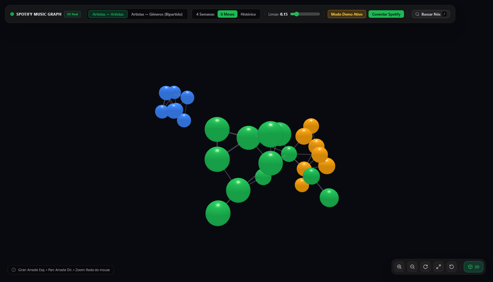
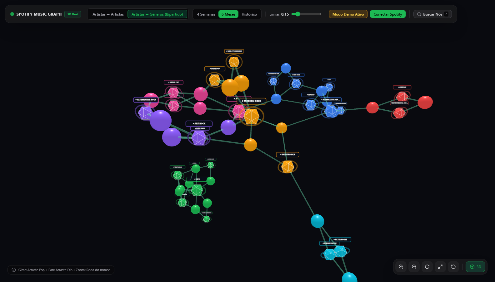
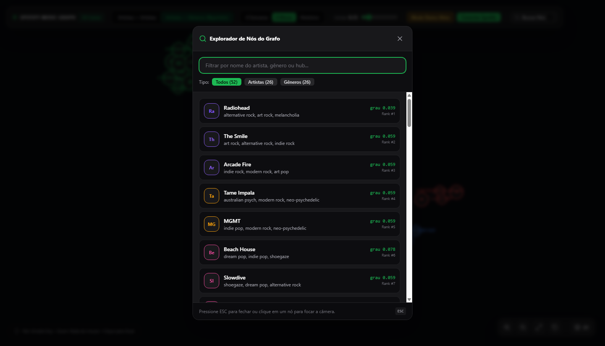
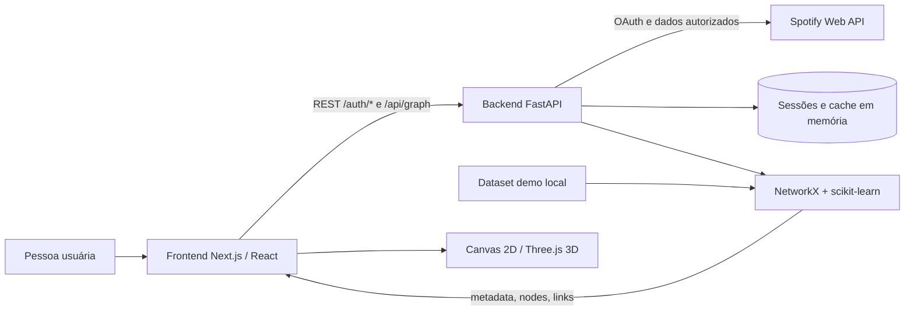

# BeatCode

<p align="center"><strong>Explore as conexões do seu gosto musical em grafos interativos.</strong><br>Uma aplicação open source que transforma dados autorizados do Spotify em redes de artistas, gêneros e comunidades.</p>

<p align="center">
  
  
  
  
</p>

<p align="center"><a href="#visão-geral">Sobre</a> · <a href="#funcionalidades">Funcionalidades</a> · <a href="#arquitetura">Arquitetura</a> · <a href="#instalação">Instalação</a></p>

---

## Preview

O grafo de artistas apresenta afinidades e comunidades calculadas a partir do dataset de demonstração incluído.

<p align="center"></p>
<p align="center"><sub>Aplicação local em modo demo · grafo de artistas · visualização 3D</sub></p>

## Visão geral

O BeatCode conecta uma conta Spotify autorizada e transforma os principais artistas do ouvinte em uma rede explorável. O motor combina gêneros, colaborações em faixas e coocorrências recentes para revelar afinidades musicais.

O modo demo, com dados fictícios incluídos, permite explorar a interface sem login ou credenciais. Os dados são ilustrativos e não representam uma conta real.

## Funcionalidades

- **Grafo de artistas:** afinidades compostas e comunidades destacadas por cor.
- **Grafo bipartido:** relações entre artistas e gêneros em conjuntos separados.
- **Visualização 3D e 2D:** Three.js/WebGL e Canvas 2D, com fallback quando WebGL não está disponível.
- **Controles:** orbit, pan, zoom, enquadramento, reset da câmera e foco em nós.
- **Busca e inspeção:** atalho `/`, filtros por tipo e navegação entre nós relacionados.
- **Painel topológico:** modularidade, arestas, clusters e artista com maior centralidade de intermediação.
- **Filtros:** três horizontes de tempo e limiar mínimo das arestas.
- **OAuth 2.0:** autenticação Spotify no servidor; tokens fora do estado do cliente.
- **Acessibilidade:** respeita `prefers-reduced-motion` e permite busca por teclado.

### Grafo bipartido

Artistas aparecem como nós circulares e gêneros como nós poligonais, com cores que distinguem comunidades e relações.

<p align="center"></p>

### Busca e exploração

A busca filtra nós por nome e tipo e permite selecioná-los para inspeção no grafo.

<p align="center"></p>

## Galeria

| Tela | Descrição |
| --- | --- |
| [Grafo de artistas](docs/screenshots/grafo-artistas.png) | Afinidades e comunidades. |
| [Grafo 2D](docs/screenshots/grafo-2d.png) | Alternativa Canvas para explorar artistas. |
| [Grafo bipartido](docs/screenshots/grafo-bipartido.png) | Relações entre artistas e gêneros. |
| [Explorador](docs/screenshots/explorador.png) | Busca e seleção de nós. |

Capturas feitas da aplicação local com o dataset demo. A viewport móvel foi exercitada, mas o canvas não renderizou de forma confiável durante a emulação; por isso, não é apresentada como captura completa.

## Tecnologias

| Camada | Stack |
| --- | --- |
| Frontend | Next.js 14, React 18, JavaScript/JSX, Tailwind CSS, Lucide React |
| Visualização | `react-force-graph-3d`, `react-force-graph-2d`, Three.js, D3 Force |
| Backend | Python, FastAPI, Uvicorn, Spotipy |
| Ciência de dados | NetworkX, NumPy, scikit-learn (TF-IDF e similaridade de cosseno) |
| API e autenticação | Spotify Web API, OAuth 2.0, OpenAPI 3.1 |
| Testes | Pytest, HTTPX |
| Persistência | Sem banco configurado; sessões OAuth e cache ficam em memória no servidor. |

## Arquitetura

O frontend Next.js consome a API FastAPI. O backend valida sessões OAuth no servidor, consulta a Spotify Web API e constrói os grafos; no modo demo, usa dados locais. A API mantém o contrato `metadata`, `nodes` e `links`.



### Motor topológico

No modo `artists`, as conexões combinam similaridade de gêneros (65%), colaborações (25%) e coocorrência recente (10%). A rede usa vizinhos mais próximos (`k=5`) e árvore geradora máxima. Louvain calcula comunidades e modularidade; a centralidade de intermediação usa a distância inversa do peso. `bipartite` separa artistas e gêneros.

## Estrutura do repositório

```text
.
├── backend/
│   ├── main.py                 # API, OAuth, demo e grafos
│   ├── requirements.txt        # Dependências Python
│   └── tests/                  # Testes do backend
├── frontend/
│   ├── app/                    # Página e estilos Next.js
│   ├── components/             # Interface e grafo
│   └── package.json            # Dependências e scripts npm
├── docs/screenshots/           # Capturas reais
├── openspec/                   # Especificações e OpenAPI
└── notes/                      # Roadmap e notas
```

## Instalação

### Pré-requisitos

Git, Python 3.10 ou superior, Node.js 18.17 ou superior e npm.

O modo demo não requer conta Spotify nem `.env`. Para OAuth, crie um app no [Spotify Developer Dashboard](https://developer.spotify.com/dashboard), configure as variáveis de `backend/.env.example` e use `http://127.0.0.1:8000/auth/callback` como redirect URI. Mantenha credenciais em `backend/.env`; nunca as publique.

### 1. Clonar

```powershell
git clone https://github.com/guilhermeaugusto777/BeatCode.git
cd BeatCode
```

### 2. Backend

No Windows PowerShell:

```powershell
cd backend
python -m venv .venv
.\.venv\Scripts\Activate.ps1
pip install -r requirements.txt
uvicorn main:app --host 127.0.0.1 --port 8000 --reload
```

Para OAuth, em outro terminal na raiz, crie e preencha `backend/.env` a partir do exemplo. Para demo, pule essa etapa:

```powershell
Copy-Item backend/.env.example backend/.env
```

### 3. Frontend

Em outro terminal na raiz:

```powershell
cd frontend
npm ci
npm run dev
```

Abra `http://127.0.0.1:3000` e selecione **Usar Dados Demo**. Swagger: `http://127.0.0.1:8000/docs`; contrato: `openspec/openapi.yaml`.

## Testes e qualidade

Com o ambiente virtual ativo:

```powershell
cd backend
pytest -v tests
```

Não há scripts de teste nem lint no frontend. Para compilar:

```powershell
cd frontend
npm ci
npm run build
```

