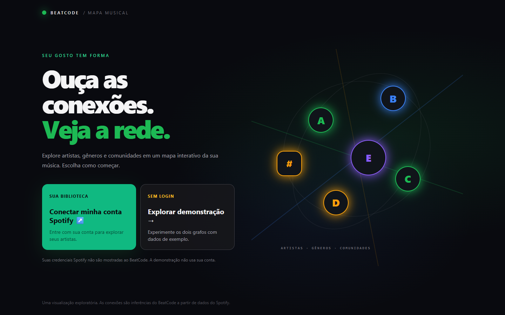
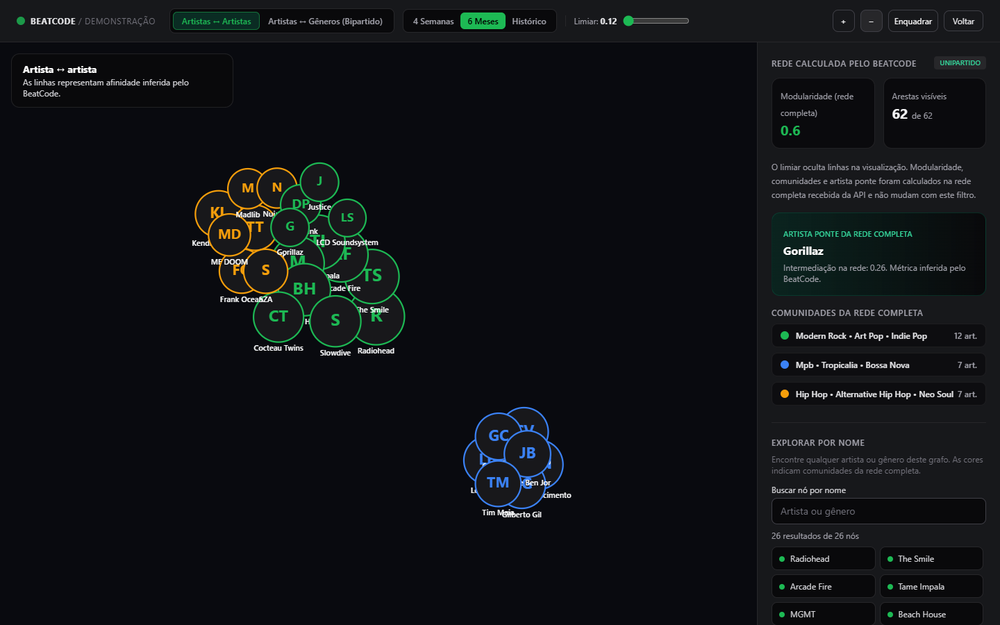
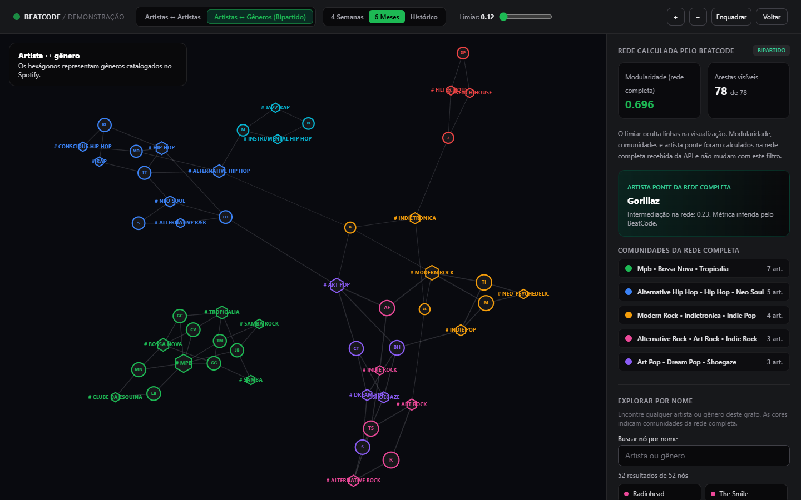

# BeatCode

**Explore o seu mapa musical.** O BeatCode transforma dados autorizados do Spotify em grafos interativos de artistas e gêneros. Também há uma demonstração local que funciona sem conta nem credenciais.

> **Estado do projeto:** aplicação local em desenvolvimento. A interface principal é **Next.js com Canvas 2D**; o backend usa FastAPI. O código ainda não possui licença open source definida pelos autores e não está preparado para implantação pública multiusuário.

## Conheça o produto

| Entrada | Grafo de artistas | Grafo artista–gênero |
| --- | --- | --- |
| [](docs/screenshots/entrada.png) | [](docs/screenshots/artistas-2d.png) | [](docs/screenshots/bipartido-2d.png) |

*Capturas da interface atual executada localmente em modo demo, sem dados de conta Spotify. No grafo de artistas da imagem, o zoom foi ajustado para mostrar as comunidades.*

### Funcionalidades atuais

- **Começo claro:** conectar uma conta Spotify ou explorar a demonstração sem login.
- **Dois grafos 2D:** relações inferidas entre artistas; incidência de rótulos Spotify entre artistas e gêneros no modo bipartido.
- **Exploração:** zoom, foco em nós, busca textual de todos os artistas e gêneros recebidos, seleção por mouse ou teclado e painel de detalhes.
- **Métricas visíveis:** comunidades coloridas, modularidade e artista ponte calculados pelo backend. O slider oculta arestas na tela; **não recalcula** essas métricas.
- **Três recortes de top artistas e faixas:** `short_term`, `medium_term` e `long_term` quando uma conta está conectada. O histórico de reproduções recentes é consultado separadamente.
- **OAuth local isolado por navegador:** cookies de sessão `HttpOnly`, tokens guardados no backend e logout local. O modo demo continua público.

As conexões são **inferências do BeatCode**, não recomendações ou notas fornecidas pelo Spotify. Veja [como os pesos são calculados](docs/modelo-matematico.md) e [o que foi validado](docs/validacao-do-modelo.md).

## Instalação local

### Pré-requisitos

- Python 3.11 e [`uv`](https://docs.astral.sh/uv/getting-started/installation/).
- Node.js **20.19+** e npm (a validação local usou Node 24.22.1).
- Git para clonar o projeto. Conta e aplicativo Spotify são opcionais para o modo demo.

Clone o repositório e execute os comandos **na raiz do checkout** — a pasta que contém `backend/` e `frontend/`:

```powershell
git clone https://github.com/guilhermeaugusto777/BeatCode.git
cd BeatCode
```

**Windows PowerShell — terminal 1, API:**

```powershell
uv venv --python 3.11 backend/.venv
uv pip install -r backend/requirements-dev.txt --python backend/.venv/Scripts/python.exe
backend/.venv/Scripts/python.exe -m uvicorn main:app --app-dir backend --host 127.0.0.1 --port 8000 --reload
```

**macOS/Linux — terminal 1, API:**

```sh
uv venv --python 3.11 backend/.venv
uv pip install -r backend/requirements-dev.txt --python backend/.venv/bin/python
backend/.venv/bin/python -m uvicorn main:app --app-dir backend --host 127.0.0.1 --port 8000 --reload
```

**Terminal 2, interface (todos os sistemas):**

```sh
npm ci --prefix frontend
npm run dev --prefix frontend
```

Abra **http://127.0.0.1:3000** e escolha **Explorar demonstração**. Teste ambos os grafos sem criar `.env`. A documentação interativa da API fica em **http://127.0.0.1:8000/docs**; o contrato versionado está em [`openspec/openapi.yaml`](openspec/openapi.yaml).

### Conectar uma conta Spotify (opcional)

Crie um aplicativo no [Spotify Developer Dashboard](https://developer.spotify.com/dashboard) e cadastre exatamente `http://127.0.0.1:8000/auth/callback` como Redirect URI. Copie `backend/.env.example` para `backend/.env`, preencha `SPOTIPY_CLIENT_ID` e `SPOTIPY_CLIENT_SECRET` localmente e reinicie a API. Confira que `FRONTEND_URL` usa a origem exibida no navegador, normalmente `http://127.0.0.1:3000`. Não versione o `.env`.

O botão **Conectar minha conta Spotify** inicia o fluxo OAuth. O botão de saída invalida a sessão **local**; não revoga a autorização no Spotify. Não use `localhost` em um serviço e `127.0.0.1` no outro, pois cookies e origem precisam coincidir.

## Arquitetura e documentação

```text
frontend/       Next.js 16, React 19, Canvas 2D e busca
backend/        FastAPI, OAuth, dataset demo, motor e testes
openspec/       contrato OpenAPI e requisitos verificáveis
docs/           arquitetura, método matemático, validação e capturas
```

O Next.js consulta a API FastAPI. A API usa o dataset demo ou, após autorização, consulta a Spotify Web API e devolve `metadata`, `nodes` e `links`. Sessões e tokens ficam em memória de um único processo. A página `backend/index.html` ainda existe como interface legada durante a transição, mas não é a interface principal. Leia a [arquitetura e seus limites](docs/arquitetura.md).

## Verificação

Após instalar as dependências, na raiz do checkout (PowerShell):

```powershell
Push-Location backend
.\.venv\Scripts\python.exe -m pytest -q
Pop-Location
npm run lint --prefix frontend
npm run build --prefix frontend
npm audit --prefix frontend --audit-level=moderate
uvx pip-audit -r backend/requirements-dev.txt --progress-spinner off
```

O equivalente macOS/Linux usa `backend/.venv/bin/python` dentro de `backend/`. Os testes de autenticação usam mocks; não precisam de conta Spotify. Os experimentos reproduzíveis e os comandos estão em [Validação do modelo](docs/validacao-do-modelo.md). O frontend ainda não possui teste automatizado de interação Canvas; verifique mudanças visuais em navegador.

## Contribuição, segurança e licença

Leia [`CONTRIBUTING.md`](CONTRIBUTING.md) antes de enviar um PR. Para relatar um problema de segurança, siga [`SECURITY.md`](SECURITY.md) e não publique dados sensíveis em issues. **Licença pendente de decisão dos autores:** até existir um arquivo `LICENSE`, não presuma permissão para redistribuir ou relicenciar o código, marcas, capturas ou dados de terceiros.
