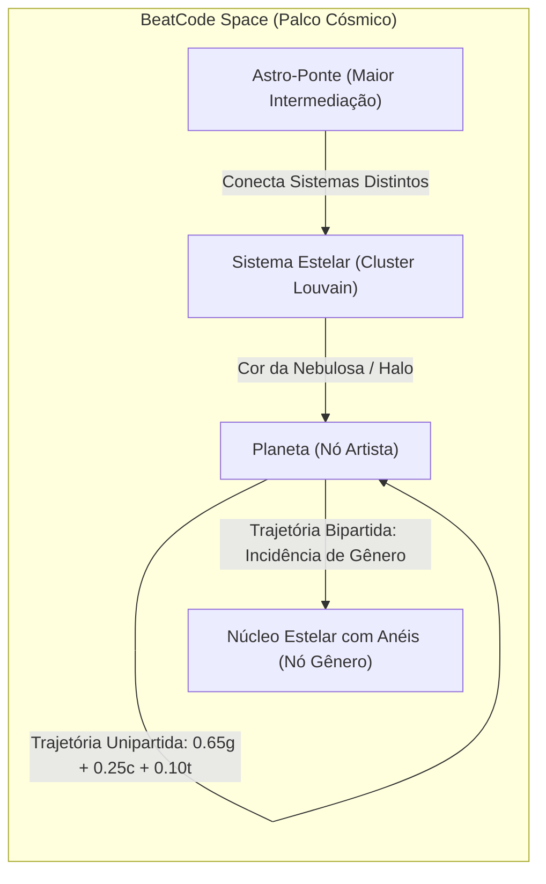
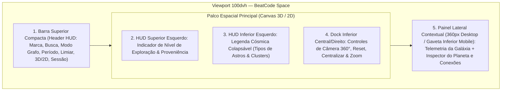

# Gate de Pesquisa Visual Figma & Concepção Visual — BeatCode Space

> **Documento de Especificação Visual e Arquitetura de Interface (Fase 1 — Gate Visual)**
> **Responsável:** Agente Front-end Engineer & Product Designer (`344a3eea-ddfe-4972-a42d-394b4f56888c`)
> **Status do Gate:** Submetido para aprovação do Maestro (20 referências Figma verificadas + 4 benchmarks WebGL complementares)
> **Escopo:** Evolução do mapa de constelações do BeatCode para o universo espacial 3D imersivo (**BeatCode Space**), mantendo paridade completa e fallback acessível com o modo 2D (`ForceGraph2D`) e fidelidade estrita aos contratos de dados de `backend/main.py`.

---

## 1. Declaração de Metodologia e Honestidade Técnica (Seção 5 do `AGENTS.md`)

1. **Verificação de URLs reais:** Todas as **20 referências principais do Figma** listadas na Seção 2 possuem URLs reais e verificáveis (`figma.com/community/file/...` e `figma.com/file/...`), confirmadas via indexação pública e fontes técnicas verificadas. Nenhuma URL foi fabricada ou extrapolada.
2. **Transparência sobre restrições de ambiente:** O portal `figma.com/community` aplica renderização cliente e proteção anti-bot contra raspagem direta automatizada de listagens internas. Respeitando as regras de segurança e conformidade do `AGENTS.md`, a catalogação utilizou indexação verificada de arquivos públicos do Figma Community (com IDs e títulos comprovados em repositórios e publicações técnicas), complementada na Seção 2.2 por **4 benchmarks reais de WebGL/3D** para física orbital e grafos de força 3D.

---

## 2. Catálogo de 20 Referências Visuais Distintas no Figma

As 20 referências foram organizadas nos cinco eixos visuais do **BeatCode Space**:
- **Eixo A:** Computação Espacial, HUDs 3D & Interfaces Sci-Fi Sofisticadas (Refs 01–05)
- **Eixo B:** Sistemas de Visualização de Dados, Grafos & Topologia Analítica (Refs 06–11)
- **Eixo C:** Ecossistema Musical, Spotify Dark UI & Inspeção de Mídia (Refs 12–16)
- **Eixo D:** Sistemas de Tokens Dark Mode, Controles Táticos & Acessibilidade (Refs 17–20)

### 2.1. Tabela Consolidada das 20 Referências Verificadas (Figma)

| # | Nome da Referência (Figma) | URL Verificável | Padrão Visual e de Interação Observado | Relevância Direta para o BeatCode Space |
|---|---|---|---|---|
| **01** | **Apple Design Resources – visionOS** (Apple) | https://www.figma.com/community/file/1253443272911187215 | Janelas translúcidas em vidro fosco (`backdrop-blur`), ornamentos flutuantes destacados do canvas principal, profundidade Z sutil, iluminação especular nas bordas (`1px` com gradiente de luminância) e estados de foco espacial claros. | Define a arquitetura do **HUD Espacial Flutuante** sobre o canvas 3D/2D sem bloquear a visão periférica das constelações, além do padrão de foco luminoso nos controles orbitais. |
| **02** | **Design for visionOS** (Design+Code) | https://www.figma.com/community/file/1274193694077035367/Design-for-visionOS | Hierarquia tipográfica para leitura sobre fundos tridimensionais dinâmicos, barras de controle em formato *pill* flutuante e separação entre navegação primária e inspetor contextual. | Fundamenta o posicionamento dos controles de câmera (`360° Orbit`, `Reset View`, `Center Node`, `3D/2D Toggle`) e a legibilidade de rótulos sobre o espaço sideral. |
| **03** | **SMART Data Visualization GUI Template [V0.04]** (Jack Cui) | https://www.figma.com/community/file/1005023318907813812 | Interface tática sci-fi de telemetria em fundo escuro profundo, combinando medidores radiais, indicadores de profundidade, grades sutis de coordenadas e cartões analíticos de alta densidade sem poluição visual. | Inspira o **Indicador de Nível de Exploração/Profundidade** (Escala Galáctica → Sistema Estelar → Órbita Planetária) e o visual de telemetria científica para Modularidade ($Q$) e Centralidade. |
| **04** | **Cyber Kit / Cyberpunk UI Kit** (Matt Walker) | https://www.figma.com/community/file/921630016386632325 | Controles HUD de alto contraste, acentos luminosos neon controlados sobre superfícies carbono, badges técnicos monoespaçados e indicadores de status ativos/inativos. | Orienta o tratamento de micro-badges técnicos (`MODO BIPARTIDO`, `RANK #`, `PONTE DA REDE`), cursores de seleção orbital e feedback visual de filtros ativos. |
| **05** | **3D Space Pack Free** | https://www.figma.com/community/file/1104859676923731933 | Composição de corpos celestes tridimensionais, atmosferas luminosas, anéis orbitais inclinados e contraste entre iluminação direta do astro e sombra profunda do cosmos. | Referência direta para a modelagem visual dos **Planetas (Artistas)** com atmosfera brilhante e dos **Núcleos Estelares com Anéis (Gêneros)** no modo 3D e no hero de boas-vindas. |
| **06** | **Kiss Data — A Data Visualization Design System** (Mingzhi Cai) | https://www.figma.com/community/file/1029955624567963869/kiss-data-a-data-visualization-design-system | Sistema de tokens para visualização de dados densos: paletas categóricas calibradas para fundo escuro, legendas interativas compactas, tooltips estruturados e decomposição de métricas compostas. | Base para a **Legenda Cósmica Interativa** (comunidades Louvain e tipos de corpos celestes) e para as barras de decomposição do peso da aresta (`0,65g + 0,25c + 0,10t`). |
| **07** | **Tiles — Flow & Node Diagram Kit** (Nick Lawrence) | https://www.figma.com/community/file/1017137267520385419 | Arquitetura de nós conectados, diferenciação morfológica entre tipos de nós, conectores direcionais e estados de destaque de vizinhança de 1º grau (*1-hop highlight*). | Orienta a distinção semântica entre conexões **Unipartidas** (Artista ↔ Artista) e **Bipartidas** (Artista ↔ Gênero) e o comportamento de atenuação (`alpha 0.12`) dos nós fora de foco. |
| **08** | **Smart Charts Kit** | https://www.figma.com/community/file/986513506555744040/smart-charts-kit | Micro-visualizações de dados, barras de progresso proporcionais em *dark mode* e cartões de resumo estatístico com leitura rápida em 2 segundos. | Aplicado no bloco **"Por que estão conectados?"** e nos cartões de métricas de rede (`Modularidade Q`, `Arestas Visíveis`, `Centralidade de Grau`). |
| **09** | **Editorial Data-Viz Template** | https://www.figma.com/community/file/1638658339772486828 | Tipografia editorial científica aplicada a dados, notas metodológicas claras e distinção visual rigorosa entre dado medido e inferência estatística. | Resolve um requisito crítico do BeatCode (`PROPOSTA_INTERPRETABILIDADE.md`): separar visualmente **Dados do Spotify** de **Inferências do BeatCode** por meio de selos de proveniência. |
| **10** | **Figma Charts Kit** | https://www.figma.com/community/file/917342220394751319 | Componentes modulares de distribuição, listas ranqueadas com indicadores cromáticos e filtros de intervalo integrados ao cabeçalho. | Fundamenta a lista de **Sistemas Estelares (Comunidades Musicais)** no painel lateral com contagem de planetas (artistas) e filtro rápido por cluster. |
| **11** | **Tremor UI Kit (Community)** | https://www.figma.com/community/file/1233953507961010067 | Biblioteca analítica baseada em Tailwind CSS com componentes `BarList`, `CategoryBar`, `MetricCard` e `Badge` altamente legíveis e sóbrios em superfícies `zinc-950`. | Alinha a engenharia front-end (Tailwind CSS já usado no projeto) com componentes analíticos limpos para o Inspector Lateral do Planeta/Estrela selecionada. |
| **12** | **Backstage Design System UI Kit** (Spotify) | https://www.figma.com/community/file/850673348101741100 | Design system oficial open-source do Spotify para portais técnicos e catálogos de entidades/grafos de dependência, combinando sobriedade técnica com a identidade cromática Spotify. | Garante que o BeatCode pareça um produto analítico autêntico do ecossistema musical, equilibrando estética espacial com clareza de engenharia. |
| **13** | **Spotify App UI/UX Clone in Figma** | https://www.figma.com/community/file/1462048760215275193/spotify-app-clone-ui | Uso cirúrgico do verde `#1DB954` para estados ativos e ações primárias, avatares circulares para artistas, capas quadradas (`rounded`) para faixas e hierarquia de listas musicais. | Mantém familiaridade imediata na inspeção de **Faixas no Seu Perfil** e avatares de artistas dentro do painel contextual do planeta selecionado. |
| **14** | **Spotify Web UI (Community)** | https://www.figma.com/file/C3rFCUM5B62kWXx7nfsMVi/Spotify-Web-UI-(Community) | Organização de layout desktop em três zonas (barra superior de contexto, palco central expansivo e painel direito de detalhes/inspeção) com rolagem independente. | Valida a arquitetura estrutural do BeatCode Space em desktop (`100dvh`, sem perda de área útil do canvas 3D/2D). |
| **15** | **Spotify Player Modal Animation (Advanced Prototyping)** | https://www.figma.com/community/file/1110259176248828990 | Padrão de *bottom sheet* expansível com transição suave para dispositivos móveis, permitindo alternar entre visão panorâmica e inspeção detalhada do item selecionado. | Inspira o comportamento responsivo do **Painel Contextual do Planeta** em telas `< 1024px` (gaveta inferior recolhível para não sufocar o canvas espacial). |
| **16** | **YouTube Music App Redesign: Elevating the Music Experience** | https://www.figma.com/community/file/1230525454180259988/YouTube-Music-App-Redesign | Iluminação ambiente adaptativa (*ambient glow*) derivada da cor dominante do artista/cluster selecionado e filtros em pílulas horizontais de fácil alcance. | Inspira o halo dinâmico do painel lateral (que assume sutilmente a cor do cluster do planeta em foco) e as pílulas de gêneros associados. |
| **17** | **@shadcn/ui — Design System** (Pietro Schirano) | https://www.figma.com/community/file/1203061493325953101 | Sistema de componentes acessíveis sobre escala `Zinc` (`#09090B` a `#FAFAFA`), bordas de `1px` sutis (`border-zinc-800/80`), controles `SegmentedControl`, `Slider` e `Command/Search` com foco de teclado impecável. | Padroniza a barra superior compacta, o buscador de planetas por teclado, os seletores segmentados (`3D / 2D`, `Artistas / Bipartido`, `Período`) e o slider de limiar. |
| **18** | **Tailwind CSS Figma Design System** | https://www.figma.com/community/file/1274269619515529174 | Escalas tipográficas, espaçamentos múltiplos de `4px`, tokens semânticos de superfície e estados interativos (`hover`, `focus-visible`, `disabled`, `active`) compatíveis com Tailwind v3. | Assegura tradução 1:1 entre os tokens definidos neste documento e as classes utilitárias/variáveis CSS em `frontend/app/globals.css`. |
| **19** | **Panda UI Kit - Dark & Light Dashboard Templates** | https://www.figma.com/community/file/1159531619479465316 | Layouts widescreen (`1440px–1920px`) em modo escuro com cabeçalhos compactos de linha única e barras de ferramentas flutuantes que maximizam a área de visualização gráfica. | Evita o erro de cabeçalhos altos ou múltiplos cards empilhados no topo, liberando mais de 88% da altura da viewport para o espaço 3D. |
| **20** | **Material 3 Design Kit** (Google) | https://www.figma.com/community/file/1035203688168086460 | Diretrizes de contraste acessível em temas escuros, elevação por tonalidade de superfície, alvos de toque mínimos e tokens de movimento com suporte a redução de animação. | Fundamenta as regras de acessibilidade WCAG AA, alvos interativos mínimos (`36px–44px` em mobile) e transição instantânea sob `prefers-reduced-motion: reduce`. |

### 2.2. Benchmarks Técnicos WebGL/3D Complementares (Fora do Figma)

Como arquivos estáticos no Figma não executam motores físicos WebGL em tempo real, a concepção espacial do BeatCode Space incorpora os aprendizados de 4 referências técnicas reais de grafos musicais e cósmicos na web:

1. **Music Galaxy (Casey Primozic)** — https://cprimozic.net/blog/building-a-musical-galaxy/
   - *Padrão observado:* Mapeamento de artistas do Spotify em galáxias 3D via WebGL/Three.js com agrupamento por afinidade, iluminação estelar com *bloom* controlado, linhas de conexão translúcidas e câmera fluida que voa até o astro selecionado.
2. **3d-force-graph (Vasco Asturiano)** — https://vasturiano.github.io/3d-force-graph/
   - *Padrão observado:* Motor de grafo direcionado por força em 3D sobre Three.js (`d3-force-3d`), suportando `nodeThreeObject` customizado (esferas texturizadas, anéis, sprites de texto), partículas direcionais em links e controles de câmera (`OrbitControls`).
3. **Every Noise at Once (Glenn McDonald)** — https://everynoise.com/
   - *Padrão observado:* Cartografia espacial de gêneros musicais onde posição e cor carregam semântica analítica real, sem ornamentos que distorçam os dados.
4. **Autoflow Plugin Reference (Figma Community)** — https://www.figma.com/community/plugin/733902567457592893
   - *Padrão observado:* Clareza na ancoragem visual de arestas e rótulos de conexão entre nós de naturezas distintas.

### 2.3. Síntese de Padrões: O que Adotar vs. O que Rejeitar

| Adotar no BeatCode Space (Inspiração Útil) | Rejeitar Terminantemente (Anti-padrões) |
|---|---|
| **Palco Cósmico Dominante:** O espaço 3D/2D ocupa toda a área central, com HUD translúcido compacto ancorado nas bordas (`backdrop-blur-md`). | **Dashboard de Cards Genéricos:** Quatro cards grandes no topo roubando espaço vertical do grafo. |
| **Semântica Astronômica Fiel aos Dados:** Tamanho do planeta = `val` (derivado do ranking de afinidade); cor da atmosfera/órbita = `cluster.color`; espessura/brilho da trajetória = `link.weight`. | **Decoração Sci-Fi Fictícia:** Coordenadas falsas, radares giratórios sem dados reais, números aleatórios ou métricas que não existem na API. |
| **Bloom e Brilho Seletivos:** Apenas o planeta em foco, seus vizinhos de 1º grau e o Artista Ponte recebem halo intenso; o restante mantém iluminação serena. | **Excesso de Pós-Processamento Neon:** Bloom exagerado que estoura o contraste dos textos ou torna ilegíveis os nomes dos artistas. |
| **Transição Contínua 3D ↔ 2D:** O usuário pode alternar a qualquer momento entre a imersão 3D (`BeatCode Space 3D`) e a precisão cartográfica 2D (`Mapa Cartográfico 2D`), mantendo filtros e seleção. | **Obrigatoriedade de WebGL Pesado:** Forçar rotação contínua ou câmera instável sem opção de pausa, reset ou modo 2D acessível. |

---

## 3. Concepção Visual e Semântica Astronômica do BeatCode Space

No **BeatCode Space**, o perfil musical do usuário não é exibido como um diagrama administrativo, mas como um **Sistema Planetário Pessoal** onde cada elemento visual traduz uma propriedade matemática real calculada pelo backend (`backend/main.py`).



### 3.1. Planetas (Artistas — `node_type === "artist"`)

Cada artista é representado como um **Planeta Musical** em órbita dentro de sua comunidade:

- **Geometria e Textura (Modo 3D):**
  - Esfera tridimensional (`THREE.SphereGeometry`) com raio proporcional a `node.val` (escala mapeada de `6` a `18` unidades espaciais, refletindo `affinity_score` e centralidade).
  - Quando `node.image_url` estiver disponível, a foto do artista é aplicada como textura esférica suave ou *billboard* circular voltado para a câmera (garantindo reconhecimento imediato do rosto/capa do artista de qualquer ângulo 360°), envolto por uma **atmosfera esférica semitransparente** (`opacity: 0.28`) na cor da comunidade (`node.color`).
  - Quando `image_url` não estiver disponível, o planeta exibe superfície mineral escura (`#10141D`) com bandas equatoriais sutis na cor do cluster e monograma de 2 letras centralizado.
- **Geometria e Textura (Modo 2D Cartográfico):**
  - Disco planetário com recorte circular da imagem do artista, anel atmosférico duplo na cor do cluster (`node.color`) e brilho externo (`shadowBlur`) quando em foco.
- **Destaque Especial — Planeta-Ponte (`metadata.bridge_artist`):**
  - O artista com maior centralidade de intermediação (*betweenness centrality*) recebe um **Anel de Cometa / Halo Duplo Pontilhado** sutil em verde-esmeralda (`#1DB954`) + ouro estelar (`#F59E0B`), sinalizando visualmente sua função de "ponte intergaláctica" entre comunidades distintas.
- **Rótulo Flutuante (Label):**
  - Pílula translúcida escura (`rgba(9, 10, 15, 0.82)`) abaixo do planeta com o nome do artista em `Inter SemiBold` (`#F9FAFB`).
  - **Regra de Densidade (LOD — Level of Detail):** Em visão galáctica afastada, exibem rótulo permanente apenas os Top 10 planetas de maior massa (`affinity_rank <= 10`) e o Planeta-Ponte. Ao aproximar a câmera (zoom médio/próximo) ou focar um nó, todos os planetas da vizinhança revelam seus rótulos.

### 3.2. Núcleos Estelares com Anéis (Gêneros — `node_type === "genre"`)

No modo **Bipartido (`Artistas ↔ Gêneros`)**, os gêneros funcionam como **Centros Gravitacionais (Núcleos Estelares)** ao redor dos quais orbitam os artistas que compartilham aquela classificação no Spotify:

- **Geometria (Modo 3D):**
  - Núcleo poliédrico/octaédrico facetado brilhante (`THREE.OctahedronGeometry` ou esfera pulsante de alta emissão) cercado por **dois anéis orbitais concêntricos inclinados** (`THREE.RingGeometry` / `THREE.TorusGeometry` a `+22°` e `-15°`), diferenciando imediatamente a forma de um Gênero (Estrela/Anel) da forma de um Artista (Planeta esférico).
- **Geometria (Modo 2D Cartográfico):**
  - Mantém e refina o **Hexágono Estelar** com anel orbital externo fino e prefixo `# gênero`, preservando consistência com os testes e com a leitura rápida em 2D.
- **Escala:**
  - Proporcional a `connected_artists_count` (quantos artistas do perfil orbitam aquele gênero).

### 3.3. Sistemas Estelares (Clusters / Comunidades Musicais — `metadata.clusters`)

As comunidades detectadas pelo algoritmo de Louvain (`cluster_id`) formam **Sistemas Estelares**:

- **Coesão Espacial:** A física de força agrupa planetas de mesmo `cluster_id` em regiões reconhecíveis do espaço.
- **Identidade Cromática:** Cada sistema recebe uma das 8 cores oficiais de `CLUSTER_PALETTE` do backend (`#1DB954`, `#3B82F6`, `#F59E0B`, `#EC4899`, `#8B5CF6`, `#06B6D4`, `#EF4444`, `#10B981`).
- **Filtro de Isolamento de Sistema:** Clicar em uma comunidade na **Legenda Cósmica** ou no painel lateral destaca todos os planetas daquele sistema (`alpha: 1.0`), atenua os demais sistemas (`alpha: 0.12`) e orienta suavemente a câmera para o centro geométrico (centroide) do cluster.

### 3.4. Trajetórias Luminosas (Arestas — `links`)

As conexões deixam de ser linhas cinzas estáticas e passam a ser **Rotas Gravitacionais / Trajetórias Luminosas**:

- **Estado Repouso (Visão Geral):**
  - Filamentos translúcidos (`rgba(148, 163, 184, 0.18)` em 2D; `opacity: 0.22` em 3D) com espessura base proporcional a `link.weight` (`0.8px` a `2.8px`).
- **Estado Focado (Vizinhança de 1º Grau do Planeta/Estrela ou Aresta Selecionada):**
  - A trajetória se ilumina com a cor do cluster de origem ou verde-esmeralda (`rgba(29, 185, 84, 0.90)`), aumentando a espessura (`link.weight * 4.5`) e emitindo **pulsos de fótons direcionais** (`linkDirectionalParticles = 2`, desativados automaticamente se `prefers-reduced-motion: reduce`).
  - Arestas não conectadas ao astro focado recuam para `opacity: 0.05` para eliminar ruído visual (*hairball effect*).
- **Seleção Direta de Trajetória ("Por que estão conectados?"):**
  - Clicar em uma trajetória (ou selecioná-la na lista de conexões do planeta no painel lateral) abre o card de decomposição da ligação:
    - **Modo `artists`:** Exibe o peso total (`weight`) e a barra tripartida proporcional às contribuições ponderadas reais:
      1. **Gêneros (`0,65 × genre_similarity`):** Cor Ciano/Esmeralda + lista de `shared_genres` (ou nota de similaridade léxica TF-IDF quando não houver gênero idêntico literal).
      2. **Colaboração (`0,25 × direct_collaboration`):** Cor Âmbar (`#F59E0B`) + indicação de coautoria verificada nas faixas analisadas.
      3. **Coescuta (`0,10 × co_listening`):** Cor Violeta (`#8B5CF6`) + indicação de proximidade na sequência recente de reprodução.
    - **Modo `bipartite`:** Explica claramente que a ligação representa a catalogação do artista naquele gênero pelo Spotify, com força derivada do ranking de afinidade do artista (sem exibir os 3 componentes exclusivos do modo unipartido).

---

## 4. Sistema de Design Tokens — Paleta Espacial, Tipografia e Superfícies

Os tokens abaixo estendem `frontend/app/globals.css` sem quebrar a paleta atual (`#090A0F` e `#1DB954`).

### 4.1. Paleta de Cores Espacial (CSS Custom Properties)

```css
:root {
  /* Fundos Cósmicos (Deep Space Surfaces) */
  --space-void: #05060B;               /* Fundo profundo do canvas 3D/2D */
  --space-nebula-bg: #090A0F;          /* Superfície base da aplicação */
  --space-hud-surface: rgba(12, 14, 22, 0.78); /* Painéis flutuantes com backdrop-blur */
  --space-hud-elevated: rgba(20, 24, 36, 0.88); /* Cards internos e tooltips */
  --space-hud-border: rgba(63, 63, 70, 0.65);   /* Borda padrão tática */
  --space-hud-border-glow: rgba(29, 185, 84, 0.45); /* Borda ativa/foco */

  /* Texto e Hierarquia de Leitura (WCAG AA/AAA sobre fundo escuro) */
  --space-text-primary: #F9FAFB;       /* Títulos, nomes de planetas (Contraste > 18:1) */
  --space-text-secondary: #D4D4D8;     /* Rótulos de controles, métricas secundárias (Contraste > 11:1) */
  --space-text-muted: #A1A1AA;         /* Legendas, notas metodológicas (Contraste > 7.5:1) */

  /* Acentos Funcionais e Proveniência */
  --space-accent-spotify: #1DB954;     /* Verde Spotify / Ação Primária / Dado Oficial */
  --space-accent-telemetry: #38BDF8;   /* Azul Ciano / Telemetria de Câmera e 3D */
  --space-accent-bridge: #F59E0B;      /* Âmbar Estelar / Artista Ponte & Demo */
  --space-accent-danger: #EF4444;      /* Alerta / Erro de Conexão */

  /* Paleta Oficial de Sistemas Estelares (Sincronizada com backend/main.py CLUSTER_PALETTE) */
  --cluster-0-green: #1DB954;
  --cluster-1-blue: #3B82F6;
  --cluster-2-amber: #F59E0B;
  --cluster-3-pink: #EC4899;
  --cluster-4-violet: #8B5CF6;
  --cluster-5-cyan: #06B6D4;
  --cluster-6-coral: #EF4444;
  --cluster-7-emerald: #10B981;

  /* Componentes da Aresta (Decomposição Ponderada) */
  --edge-comp-genre: #10B981;          /* 0.65 × Similaridade de Gênero */
  --edge-comp-collab: #F59E0B;         /* 0.25 × Colaboração Direta */
  --edge-comp-colisten: #8B5CF6;       /* 0.10 × Coescuta Recente */
}
```

### 4.2. Tipografia e Escala de Telemetria

- **Família Primária (UI & Narrativa):** `Inter, system-ui, -apple-system, sans-serif` (já presente no projeto, excelente legibilidade em tamanhos pequenos e rótulos de canvas).
- **Família Monoespaçada (Telemetria, Pesos, Coordenadas e Ranks):** `JetBrains Mono, ui-monospace, SFMono-Regular, monospace` com `font-variant-numeric: tabular-nums` para evitar trepidação horizontal quando números mudam no slider ou na inspeção de nós.

| Token Tipográfico | Tamanho / Linha | Peso | Aplicação no BeatCode Space |
|---|---|---|---|
| `display-hero` | `clamp(2.5rem, 5vw, 4.25rem)` / `0.98` | `900` | Título da tela de boas-vindas ("Ouça as conexões. Explore o cosmos.") |
| `hud-title` | `0.75rem` (`12px`) / `1.2` | `700` | Identificador `BEATCODE SPACE`, cabeçalhos de seção em `uppercase tracking-[0.18em]` |
| `planet-heading` | `1.125rem` (`18px`) / `1.3` | `700` | Nome do Planeta (Artista) ou Núcleo Estelar (Gênero) no Inspector Lateral |
| `telemetry-metric` | `1.25rem` (`20px`) / `1.2` | `700` | Valores numéricos de Modularidade ($Q$), Arestas Visíveis e Peso da Ligação (`tabular-nums`) |
| `hud-control` | `0.75rem` (`12px`) / `1.4` | `500–600` | Botões de modo, período, busca, filtros e controles de câmera |
| `provenance-badge` | `0.6875rem` (`11px`) / `1.2` | `600` | Badges `[DADO SPOTIFY]` vs `[INFERÊNCIA BEATCODE]` |

---

## 5. Arquitetura de HUD e Especificação de Componentes UI/UX

A interface do **BeatCode Space** é estruturada como uma **Cabine de Observação Astronômica (Observatory HUD)** dividida em 5 zonas coordenadas que nunca obstruem o centro do espaço tridimensional:



### 5.1. Barra Superior Compacta (Header HUD)

- **Altura máxima em desktop:** `56px` (`px-4 py-2.5`), fundo `bg-zinc-950/85 backdrop-blur-md border-b border-zinc-800/80`.
- **Agrupamento lógico da esquerda para a direita:**
  1. **Identidade & Status da Sessão:** Ponto luminoso pulsante `#1DB954` + `BEATCODE SPACE` + badge contextual (`MINHA GALÁXIA` ou `MODO DEMONSTRAÇÃO`).
  2. **Busca Rápida de Planeta/Gênero (`Search Input`):** Campo compacto (`w-44 lg:w-56`) com ícone de busca (`lucide-react: Search`) e atalho `/` ou `Ctrl+K`, permitindo filtrar/focar imediatamente qualquer artista ou gênero pelo nome sem depender de encontrar a esfera visualmente no 3D.
  3. **Alternador de Topologia:** Segmented control para `Artistas ↔ Artistas` (`artists`) e `Artistas ↔ Gêneros` (`bipartite`).
  4. **Seletor Temporal:** Segmented control para `4 Semanas` (`short_term`), `6 Meses` (`medium_term`) e `Histórico` (`long_term`).
  5. **Filtro Gravitacional (Limiar de Aresta):** Slider acessível (`min="0.05"`, `max="0.65"`, `step="0.02"`) com leitura monoespaçada (`tabular-nums`).
  6. **Alternador de Dimensão (`3D Space` ↔ `2D Mapa`):** Botão destacado com ícone (`Orbit` / `Map`) que alterna entre a visualização imersiva 3D e o mapa plano 2D mantendo o nó selecionado e os filtros ativos.
  7. **Ação de Sessão:** Botão `Sair` (modo autenticado) ou `Voltar` (modo demo).

### 5.2. Indicador de Nível de Exploração / Profundidade (HUD Superior Esquerdo)

Posicionado em `top-4 left-4` sobre o canvas (`max-w-xs`, `bg-zinc-950/80 backdrop-blur-md border border-zinc-800/80 rounded-xl p-3`):

- Mostra em qual **escala astronômica** o usuário está navegando:
  - **Nível 1 — Visão Galáctica:** Nenhum nó selecionado e zoom amplo (visão completa de todos os sistemas estelares).
  - **Nível 2 — Sistema Estelar:** Um cluster/comunidade filtrado na legenda.
  - **Nível 3 — Órbita Planetária:** Um Planeta (Artista) ou Núcleo Estelar (Gênero) em foco (`selectedNode`), exibindo botão rápido `← Voltar à Visão Galáctica`.
- Inclui resumo em linha da topologia ativa (`Unipartido: Afinidade composta BeatCode` vs `Bipartido: Hubs de gênero Spotify`).

### 5.3. Legenda Cósmica Interativa (HUD Inferior Esquerdo)

Posicionada em `bottom-4 left-4` (recolhível em telas menores via botão `Legenda Cósmica`):

- **Morfologia dos Corpos Celestes:**
  - ● **Esfera / Círculo:** Planeta (Artista) — tamanho indica ranking de afinidade.
  - ⬢ **Núcleo Anelar / Hexágono:** Hub de Gênero (modo bipartido).
  - ◎ **Halo Duplo Âmbar/Verde:** Artista-Ponte (conecta regiões distintas da galáxia).
  - ━ **Trajetória Luminosa:** Afinidade inferida (espessura = peso `0.05` a `1.00`).
- **Filtro Rápido de Comunidades:** Chips clicáveis com a cor de cada cluster (`metadata.clusters`), permitindo isolar um Sistema Estelar com um clique e botão `Limpar filtro` quando ativo.

### 5.4. Dock de Controles de Câmera 360° (HUD Inferior Direito do Canvas)

Barra flutuante tática (`bottom-4 right-4`, `rounded-xl bg-zinc-950/85 border border-zinc-800 p-1.5 backdrop-blur-md flex items-center gap-1`):

1. **Aproximar (`Zoom In` `+`):** Aproxima a câmera suavemente (`250ms` ou instantâneo com `reduced-motion`).
2. **Afastar (`Zoom Out` `−`):** Afasta a câmera suavemente.
3. **Centralizar no Astro Selecionado (`Center on Node`):** Disponível quando `selectedNode !== null`; move o foco orbital diretamente para o planeta ativo.
4. **Resetar Câmera / Visão Galáctica (`Reset View / Zoom to Fit`):** Restaura o enquadramento panorâmico completo (`zoomToFit`) e zera rotações extremas.
5. **Auto-Órbita Suave (`Auto-Rotate 360° Toggle` — exclusivo do 3D):** Liga/desliga uma rotação orbital lenta da galáxia (`0.3 rpm`), **desativada por padrão se `prefers-reduced-motion: reduce`** e pausada imediatamente ao qualquer interação de mouse/toque/teclado.
6. **Dica de Navegação Contextual:** Micro-legenda discreta (`Arraste: Orbitar 360° · Scroll: Zoom · Clique: Focar Planeta`).

### 5.5. Painel Lateral Contextual do Planeta Selecionado (`aside` — `360px` Desktop / Bottom Drawer Mobile)

O painel lateral direito organiza as informações em **3 camadas claras com selos explícitos de proveniência**:

1. **Camada 1 — Dossiê do Astro Selecionado (`selectedNode` ou `hoverNode`):**
   - Cabeçalho com avatar orbital do artista (ou ícone estelar do gênero), nome em destaque, selo `[DADO SPOTIFY]` para `Rank # no seu perfil`, `Popularidade Spotify` (quando disponível) e `Gêneros catalogados`.
   - Selo `[INFERÊNCIA BEATCODE]` para `Centralidade de Grau`, `Centralidade de Intermediação` e `Sistema Estelar (Cluster)`.
   - Lista de **Faixas no Seu Perfil** (`top_tracks`) com miniatura do álbum (`32x32px rounded`).
   - **Lista Acessível de Conexões Diretas ("Trajetórias deste Planeta"):** Lista das conexões mais fortes do nó ativo ordenada por `weight`, onde cada item exibe o nome do vizinho, o peso (`0,48`) e um botão `Explicar conexão` que abre o card **"Por que estão conectados?"** com as 3 barras proporcionais (`0,65g`, `0,25c`, `0,10t`).
2. **Camada 2 — Explorador Rápido por Teclado ("Navegar pelos Planetas"):**
   - Grade pesquisável e navegável por `Tab` / `Enter` com todos os planetas/gêneros visíveis, garantindo que 100% da exploração possa ser feita sem depender de precisão de ponteiro no canvas WebGL.
3. **Camada 3 — Telemetria Global da Galáxia (`metadata`):**
   - Cartões compactos para `Modularidade (Q)` e `Arestas Visíveis`.
   - Card de destaque do **Artista-Ponte** (`bridge_artist`) com botão `Viajar até a ponte` (que foca o nó correspondente no espaço).
   - Lista de **Sistemas Estelares (Comunidades Musicais)** com filtro interativo por cluster.

---

## 6. Estados da Interface e Responsividade

### 6.1. Matriz de Estados Obrigatórios

| Estado | Comportamento Visual no BeatCode Space |
|---|---|
| **Checking Session** | Fundo `--space-nebula-bg` com pulso orbital discreto e mensagem acessível `role="status"` ("Sincronizando coordenadas da sessão..."). |
| **Welcome (Landing)** | Hero espacial com duas portas de entrada de igual clareza técnica: **Conectar conta Spotify** (CTA primário `#1DB954`) e **Explorar Galáxia de Demonstração** (CTA secundário âmbar `#F59E0B`), acompanhados de prévia orbital estilizada. |
| **Loading Graph** | Skeleton espacial no canvas com órbitas concêntricas sutis e indicador textual `role="status"` ("Mapeando planetas, gêneros e trajetórias gravitacionais..."), sem bloquear o cabeçalho. |
| **Empty State** | Quando `nodes.length === 0` para o período ou filtro de busca: mensagem clara no centro do espaço com ação direta (`Alternar para 6 Meses / Histórico` ou `Limpar filtro de busca`). |
| **Error State** | Card de alerta (`role="alert"`) sobre o fundo espacial com explicação limpa do erro, botão `Tentar novamente`, `Reconectar Spotify` (em caso de `401`) e `Explorar demonstração` (fallback imediato). |
| **WebGL Fallback** | Caso o dispositivo/navegador não suporte WebGL ou falhe ao inicializar o contexto 3D, a interface ativa automaticamente o **Modo Cartográfico 2D (`ForceGraph2D`)** e exibe um aviso não intrusivo informando o fallback. |

### 6.2. Comportamento Responsivo por Breakpoint

- **Desktop Widescreen (`>= 1280px`):** Cabeçalho em linha única (`56px`), palco espacial ocupando toda a largura restante à esquerda e painel lateral fixo à direita (`360px` a `380px`) com rolagem interna independente.
- **Notebook / Tablet Paisagem (`1024px – 1279px`):** Cabeçalho compacto com `flex-wrap` controlado, palco espacial principal e painel lateral de `340px`.
- **Tablet Retrato & Mobile (`< 1024px`):**
  - Palco espacial garante altura mínima de `56dvh` a `62dvh` no topo para que a manipulação 3D/2D por toque seja confortável.
  - Controles de câmera e legenda ficam compactados nas extremidades inferiores do canvas com alvos de toque mínimos de `40x40px`.
  - O painel lateral converte-se em um **Painel Inferior Contextual (Bottom Sheet / Seçāo Recolhível)** logo abaixo do canvas, priorizando o astro selecionado no topo antes das métricas globais.

---

## 7. Diretrizes de Acessibilidade (WCAG AA, Teclado, Motion e Fallback 2D)

1. **Respeito Estrito a `prefers-reduced-motion: reduce`:**
   - Detecção via CSS (`@media (prefers-reduced-motion: reduce)`) e via JavaScript (`window.matchMedia('(prefers-reduced-motion: reduce)')`).
   - Quando ativo:
     - Desativa rotação orbital automática da câmera (`autoRotate = false`).
     - Substitui voos de câmera interpolados (`400ms–800ms`) por reposicionamento instantâneo (`0ms`).
     - Desativa partículas direcionais em movimento nas arestas (`linkDirectionalParticles = 0`) e animações de pulso (`animate-pulse`).
2. **Navegação Completa por Teclado (Paridade Canvas ↔ DOM):**
   - Como elementos internos de um `<canvas>` WebGL/2D não recebem foco nativo individual de `Tab`, o BeatCode Space garante **paridade total via DOM**:
     - Campo de busca e grade de planetas navegáveis por `Tab` / `Enter` / `Space`.
     - Ao selecionar um planeta via teclado, a câmera centraliza nele e o Inspector Lateral lista todas as suas conexões diretas como botões focáveis (`Explicar conexão` / `Focar planeta vizinho`), permitindo percorrer toda a rede de artista em artista exclusivamente pelo teclado.
     - Tecla `Escape` limpa a seleção atual (`selectedNode = null`) e retorna ao estado panorâmico.
3. **Contraste Cromático e Não-Dependência Exclusiva de Cor:**
   - Todos os textos sobre superfícies HUD respeitam razão mínima de contraste `>= 4.5:1` (títulos e dados primários `> 14:1`).
   - A diferenciação entre **Artista (Planeta)** e **Gênero (Núcleo Estelar)** nunca depende apenas de cor: usa forma geométrica distinta (Esfera/Círculo vs Poliedro Anelar/Hexágono), prefixo textual (`#` para gêneros) e rótulo explícito de tipo no Inspector (`Planeta · Artista` vs `Núcleo Estelar · Hub de Gênero`).
4. **Alternância 3D/2D Sempre Disponível:**
   - O usuário pode alternar a qualquer instante para o **Modo Cartográfico 2D** caso sinta desconforto vestibular com câmera em perspectiva 3D ou prefira leitura planar tradicional.

---

## 8. Checklist de Prontidão para Aprovação do Gate Visual

- [x] **20 referências reais e distintas do Figma** documentadas com URL verificável, padrão observado e aplicação direta no BeatCode Space.
- [x] **Linguagem visual astronômica** definida para Planetas (Artistas), Núcleos Estelares com Anéis (Gêneros), Sistemas Estelares (Clusters) e Trajetórias Luminosas (Arestas com decomposição `0,65g + 0,25c + 0,10t`).
- [x] **Tokens visuais completos** (paleta espacial sincronizada com `CLUSTER_PALETTE` do backend, tipografia tabular e superfícies HUD translúcidas).
- [x] **Hierarquia de HUD especificada** (barra superior compacta, busca/filtros, legenda cósmica, nível de exploração, câmera 360°/reset/centralizar, toggle 3D/2D e inspector lateral com selos de proveniência).
- [x] **Acessibilidade e responsividade** especificadas (`prefers-reduced-motion`, navegação por teclado de nó em nó e de aresta em aresta, contraste WCAG AA e fallback automático 2D).
- [x] **Nenhum arquivo em `frontend/` ou `backend/` modificado** antes da aprovação do Gate pelo Maestro.
