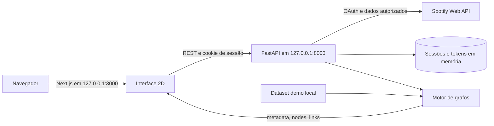

# Arquitetura do BeatCode

O BeatCode é uma aplicação **local** com interface Next.js e API FastAPI. A interface principal é o Canvas 2D; a página HTML servida pela API continua disponível como legado de transição. Não há banco de dados nem suporte de produção multiusuário nesta versão. Veja o [README](../README.md) para iniciar os serviços.

## Componentes

| Local | Responsabilidade |
| --- | --- |
| [`frontend/app/`](../frontend/app/) e [`frontend/components/SpotifyConstellationGraph.jsx`](../frontend/components/SpotifyConstellationGraph.jsx) | Entrada com Spotify ou demo, busca em todos os nós recebidos, controles, Canvas 2D e painel de métricas. Usa Next.js 16, React 19 e `react-force-graph-2d`. |
| [`backend/main.py`](../backend/main.py) | Endpoints FastAPI, OAuth via Spotipy, isolamento de sessões, consulta ao Spotify, dataset demo e cálculo dos grafos. |
| [`backend/genre_representation.py`](../backend/genre_representation.py) | Normalização e corpus de gêneros para o TF-IDF vigente. |
| [`backend/experiments/`](../backend/experiments/) | Alternativas de gênero e coescuta e dados sintéticos. Não são acionadas por `/api/graph`. |
| [`backend/tests/`](../backend/tests/) | Testes de API, autenticação com mocks, grafos, gêneros e experimentos. |
| [`openspec/openapi.yaml`](../openspec/openapi.yaml) e [`openspec/specs/`](../openspec/specs/) | Contrato HTTP e requisitos de domínio. |

## Fluxos

**Demonstração.** O frontend chama `GET /api/graph?...&demo=true`. A API usa o dataset local e retorna `metadata`, `nodes` e `links`; não exige conta Spotify. Os modos `artists` e `bipartite` compartilham a mesma interface, mas têm definições de aresta diferentes, descritas em [Modelo matemático](modelo-matematico.md).

**Conta Spotify.** O navegador inicia `GET /auth/login` no backend. O servidor cria uma sessão aleatória e um `state` de uso único para a tentativa OAuth. O Spotify redireciona para `/auth/callback`; o servidor valida cookie e `state`, troca o código e armazena tokens somente na memória da sessão. O callback retorna ao Next.js. Requisições privadas usam cookie com `credentials: "include"`; sem autenticação, `/api/graph` retorna `401`. `POST /auth/logout` invalida a sessão local e apaga o cookie, sem revogar a autorização no provedor.

**Erros do Spotify.** A API traduz falta de autorização, acesso proibido, limite de chamadas, resposta incompleta e indisponibilidade para respostas `401`, `403`, `429`, `502` e `503`, sem repassar o corpo bruto do provedor. O contrato de respostas está no [OpenAPI](../openspec/openapi.yaml).

## Segurança e limite de implantação

O cookie de sessão é `HttpOnly`, `SameSite=Lax` e usa `Secure` quando a requisição chega por HTTPS. `FRONTEND_URL` deve ser uma origem exata e CORS permite credenciais apenas para origens listadas. Respostas de autenticação e grafo recebem `Cache-Control: no-store`. O `state` OAuth expira em dez minutos; sessões, em oito horas, e um único processo mantém até 256 sessões em memória. Reiniciar o backend encerra as sessões. Múltiplos workers não compartilham autenticação. Não exponha os servidores locais à internet: implantação pública requer armazenamento compartilhado de sessões, HTTPS confiável, revisão de proxy/Host e operação de segredos.

Os testes de autenticação usam mocks, sem credenciais de Spotify. Um ensaio real só deve ocorrer com contas consentidas e configuração local; o procedimento está em [Contribuição](../CONTRIBUTING.md#testes-de-autenticação).

## Leitura correta das métricas

As comunidades, modularidade e o artista ponte são calculados no backend sobre a rede construída e podada. O controle de limiar no frontend oculta linhas **apenas na visualização**; os indicadores não são recalculados. A busca percorre todos os nós do payload, inclusive gêneros no modo bipartido. Em tela móvel estreita, rótulos do Canvas podem se sobrepor quando a rede é densa; a busca oferece um caminho textual para seleção, mas não elimina essa limitação visual. A comparação de métodos e as limitações científicas estão em [Validação do modelo](validacao-do-modelo.md).
